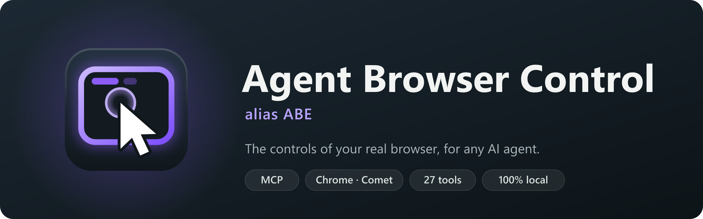
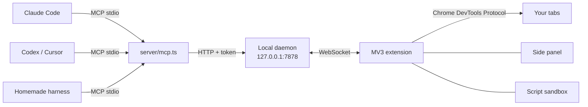

<p align="center">
  <a href="README.md">Français</a> · <b>English</b>
</p>

<p align="center">
  
</p>

<p align="center">
  <b>Agent Browser Control</b> (ABC for short) gives any AI agent, whether it's Claude Code, Codex, Cursor or a
  homemade harness running on DeepSeek, the controls of <b>your real browser</b>:
  your tabs, your sessions, and everything the DevTools can see.<br>
  One Chrome extension, one MCP server, and that's it.
</p>

<p align="center">
  <a href="#installation">Installation</a> ·
  <a href="#the-tools">The 35 tools</a> ·
  <a href="#the-side-panel">The side panel</a> ·
  <a href="#security">Security</a> ·
  <a href="#architecture">Architecture</a>
</p>

<p align="center">
  
</p>

## Why Agent Browser Control

- **Your real browser.** Not a headless Chromium running on the side: the agent works in your tabs, with the
  accounts you're already signed in to. It sees what you see.
- **Any agent.** Everything goes through [MCP](https://modelcontextprotocol.io): one line of configuration and the
  agent gets all 35 tools, whatever model runs behind it.
- **Far more than a click driver.** Accessibility tree with stable references, iframes (even cross-origin),
  network, WebSocket, console, cookies, performance, mobile emulation, request interception, GIF or video
  recording… The agent gets the DevTools, not just a mouse.
- **You stay in charge.** Each agent has its own colored tab group, every action shows up live, and an emergency
  stop cuts everything instantly.

## The side panel

<table>
  <tr>
    <td width="320"></td>
    <td>
      <p>Click the extension icon to open the panel (the interface is in French). Three views: Activité (activity), Réglages (settings), Secrets.</p>
      <ul>
        <li><b>Waiting for you</b>: an agent hands over (captcha, 2FA) or asks for a secret; the card says why and how long it will wait. The extension icon shows the number of pending requests.</li>
        <li><b>Agents</b>: one row per agent and sub-agent, with what it is doing in plain words. On each row: write to it, show its tabs, pause it, close its tabs.</li>
        <li><b>Write to an agent</b>: "Stick to French sources", "Stop after the summary"… The message reaches the agent at the top of the result of its next action; the panel shows "En attente" (pending), then "Lu à 11:30" (read at).</li>
        <li><b>Activity log</b>: every action, its site, duration and errors; filter by agent or failures, expand any line.</li>
        <li><b>Tout arrêter</b> (stop everything, or <kbd>Alt</kbd>+<kbd>Shift</kbd>+<kbd>S</kbd>): running actions stop at once and the agent is told; <kbd>Alt</kbd>+<kbd>Shift</kbd>+<kbd>R</kbd> resumes.</li>
        <li><b>Settings</b>: foreground mode, agent scripts, visible gestures, blocked sites (your bank, your password manager…).</li>
      </ul>
    </td>
  </tr>
</table>

## Installation

> Requirements: **Node.js 22.18+** and a Chromium-based browser (tested on Comet, meant for Chrome, Edge, Brave…).
> Optional: [yt-dlp](https://github.com/yt-dlp/yt-dlp) and ffmpeg for `download_media`.

**1. Get the project** (one-liner: see install.ps1 / install.sh)

```sh
git clone https://github.com/salmund/agent-browser-control.git
cd agent-browser-control
npm install
```

**2. Load the extension**: open `chrome://extensions`, turn on *Developer mode*, click *Load unpacked* and pick the
`extension/` folder.

**3. Connect an agent**, with the same MCP configuration (stdio) for all of them:

```json
{
  "mcpServers": {
    "agent-browser-control": {
      "command": "node",
      "args": ["/path/to/agent-browser-control/server/mcp.ts"]
    }
  }
}
```

With Claude Code: `claude mcp add agent-browser-control -- node /path/to/agent-browser-control/server/mcp.ts`

That's all: the local daemon starts by itself on the first call. The agent's name, which is also the name of its
tab group, is the one announced by the MCP client; use `--agent-name my-agent` to pick your own.

**Or over HTTP**, if your client speaks Streamable HTTP MCP: the daemon serves `/mcp` directly, with no intermediate
process (it must already be running, for instance started by a stdio agent or by `node server/daemon.ts`). The
agent's name goes in the URL; the token is the content of the `~/.agent-browser-control/token` file:

```json
{
  "mcpServers": {
    "agent-browser-control": {
      "type": "http",
      "url": "http://127.0.0.1:7878/mcp?agent=my-agent",
      "headers": { "Authorization": "Bearer <content of ~/.agent-browser-control/token>" }
    }
  }
}
```

**First extension connection.** The daemon remembers the ID of the first extension that connects and then rejects
all others. If you load the extension from another folder (its ID changes), run `npm run unpin-extension`, then
reload it.

**Several agents in parallel.** Sub-agents of a workflow share their parent's connection, hence its name. Each one
passes a short `label` to `tabs_context` and `tabs_create`: it gets its own "agent · label" group (distinct
colour), its own chip in the panel and labelled lines in the log. Without `label`, nothing changes. Tabs still
belong to the base agent: separation between sub-agents relies on discipline (each one only works on its own
tabs), not on a prohibition.

**Your browser stays yours.** By default, agents work in the background: they don't open their tabs in the foreground
and don't change your active tab. But Chrome doesn't paint a hidden tab: virtualized lists (AngularJS Material, CDK,
react-window…) stay empty there, and mouse events wait for their timeout (a click ~5 s, a scroll 60 s). For a click, a
scroll or reading such a list, the agent's tab therefore comes to the front for the duration of the gesture (0.8 s
hold so gestures can chain), then you get your tab back. Reading, keyboard typing, navigation and screenshots touch
nothing. The "Foreground" switch in the panel restores the old behaviour (agent tab brought to the front on every action).

**Real mouse, for a machine dedicated to agents.** A simulated gesture jumps to the exact centre of its target with
no travel, which anti-bot protections (Turnstile, reCAPTCHA, DataDome…) detect. On a machine whose screen belongs to
the agents (a Linux mini-PC, say), the panel's "Real mouse" switch routes clicks, hovers, scrolls and drags through the
real pointer, moved by the daemon (X11, `xdotool`) along a hand-like path: an arc, a bell-shaped speed profile, a slight
overshoot on distant targets. The extension checks that the page saw the pointer land in the right place before
clicking, and falls back to the simulated gesture when the real mouse is unavailable. A hand-like path costs 0.5 to
1.5 s, so it is only used where a protection judges behaviour (anti-bot widget or script, Cloudflare challenge, login
page, protected site seen in the last 30 min); elsewhere gestures stay simulated and fast. The agent can decide for a
gesture (`computer`, `human: true` or `false`). Off by default: on your own PC, the pointer stays yours.

## The tools

| | Tools |
|---|---|
| **Tabs** | `tabs_context` (with each tab's age) · `tabs_create` (incognito too) · `tabs_close` · `tabs_cleanup` (closes idle tabs, `dryRun` to preview) · `history_search` (find a visited page) · `navigate` |
| **See** | `read_page` (accessibility tree with refs, iframes included: full, on-screen only or as a diff) · `find` · `scroll_extract` (infinite lists extracted in a single call) · `query` (structured extraction: selector + filter + pagination) · `read_tables` (tables as Markdown or CSV) · `get_page_text` (canvas pages too: Google Docs, Sheets, Slides export or OCR) · `save_image` · `read_screen_text` (local OCR) · `transcript` (the text of a YouTube video, without downloading anything) · `downloads` (download a file with your session, follow a download) · `read_document` (PDF, even scanned, Word, PowerPoint, Excel) |
| **Act** | `computer` (screenshot, clicks, typing, keys, scrolling, drag and drop) · `form_input` · `credentials_fill` (fills logins / passwords without ever seeing them: encrypted vault or your Vaultwarden / Bitwarden, side panel Secrets tab) · `credentials_list` · `file_upload` · `wait_for` · `handle_dialog` · `ask_human` (hand over to the user: captcha, 2FA, validation) · `captcha_solve` (solves Turnstile, reCAPTCHA, hCaptcha) |
| **DevTools** | `replay_paginated` (replay an observed API pagination, no scrolling) · `javascript` · `devtools` (console, network, interceptions, storage, perf, emulation, PDF, WebSocket, HTTP, HAR, resize: 12 tools in one) · `site_api` (per-site memory: routes + calls, replay fast without rediscovering) |
| **Record, automate** | `gif_creator` (high-quality GIF or WebM video) · `browser_script` · `download_media` (a page's video, audio or subtitles, with yt-dlp) · `watch` (persistent watches: the daemon checks on its own, periodically) · `demo` (the user shows the flow once, the agent replays it) |

A few details that make all the difference on real websites:

- **`wait_for`** waits for a condition (an element, a text appearing or disappearing, a URL, a quiet network)
  instead of a fixed number of seconds. A 9-second image generation? It hands control back at second 9.
- **Windows covering the page**, such as cookie banners or modals, are flagged at the top of every read, with the
  buttons to close them and the instruction to decline non-essential cookies. A cookie wall that offers no way to
  decline ("accept or subscribe") is accepted rather than leaving the page blocked.
- **`file_upload`** also works when the site opens the file picker on click: the system dialog is intercepted, so
  the agent never has to deal with it.
- **`read_page` in `diff` mode** only returns what changed since the previous read: less context, more speed.
- **Compound actions (1 LLM turn instead of 2 or 3)**: `navigate` and `tabs_create` accept `snapshot: true` to directly return the interactive accessibility tree as soon as loading completes; `computer` and `form_input` accept `snapshot: true` or `then: "diff"` to settle the DOM (300 ms) and return the updated tree or diff immediately.

### `browser_script`: dozens of actions in a single call

For repetitive tasks, the agent can write a small program that runs in one go, with no round trip to the model:

```js
// Today's Hacker News stories, sorted by score
await nav("https://news.ycombinator.com/");
const stories = await js(String.raw`[...document.querySelectorAll("tr.athing")].map((row) => ({
  title: row.querySelector(".titleline > a")?.textContent,
  points: parseInt(row.nextElementSibling?.querySelector(".score")?.textContent) || 0,
}))`);
return stories.sort((a, b) => b.points - a.points).slice(0, 10);
```

The script runs in a *sandbox* page of the extension, with no network and no browser APIs, and can only act
through the tools, with the same safeguards. Because it chains actions without looking at the page in between,
**it is enabled by default**: you can disable it in the side panel. More examples in
[`examples/scripts/`](examples/scripts): comparing cities on Wikipedia, checking a page for broken links.

### With Claude Code

To make Claude Code prefer Agent Browser Control over Claude in Chrome, copy the skill in
[`integrations/claude-code/skills/agent-browser-control`](integrations/claude-code/skills/agent-browser-control)
to `~/.claude/skills/`. It tells Claude when and how to use the tools (written in French).

### Vaultwarden or Bitwarden: your logins, never handed to the agent

The agent can sign in to your sites with the logins stored in **your** vault, without ever seeing them:

1. Install the Bitwarden CLI once (free, it also works with Vaultwarden): `winget install --id Bitwarden.CLI`.
2. Side panel, **Secrets** tab, **Vaultwarden / Bitwarden** block: the server address is found in your tabs or history
   (title "Vaultwarden Web", host `passwords.*`, `vault.*`) and checked; enter your email and master password (and the
   two-step code if asked). That's it.
3. The agent uses the `vaultwarden` slot: `credentials_fill` picks the vault item matching the tab's site (the vault's
   URI rules), asks for your approval in the panel, lets you choose the account when there are several, and "Always
   allow on this site" stops further prompts. `credentials_list` also shows the vault items matching the page (`bw-<id>`).
4. Vault locked when the agent needs it: a card shows up in the panel (and a notification); type your master password
   and the agent resumes on its own (2 min wait at most).

The CLI runs in a profile of its own (`~/.agent-browser-control/bitwarden`), so your usual `bw` stays logged in
(`ABC_BW_PROFILE=default` to share it). The master password is never written or logged: it reaches the CLI through an
environment variable, and the session key stays in the daemon's memory.
While the vault is open, the daemon keeps a `bw serve` on a private socket (never a network port): listing then filling
a login takes a few milliseconds instead of 3 to 4 s per CLI call (`ABC_BW_SERVE=0` to do without it). Only the page origin (not its path) is sent to
the CLI to find matching items. A private server (Tailscale, local network) must be reachable from this PC.

## Security

- **Everything stays on your machine.** The daemon listens on `127.0.0.1` with a token; it rejects any request
  coming from a web page (including through a domain name pointing to your machine) and only accepts your
  extension, pinned on its first connection.
- **Page content is data, not instructions.** Everything coming from a page is marked as untrusted, so the agent
  doesn't follow booby-trapped text. Site memory notes, written by agents, are served the same way: as unverified
  data.
- **Your sensitive files stay put.** `file_upload` refuses SSH keys, `.env`, certificates, HAR files, browser
  profiles and configuration folders, before anything reaches the page.
- **The log doesn't keep what you type**: typed text, passwords, request bodies and URL parameters are reduced to
  their length or masked.
- **Each agent stays in its own tabs**, and never enters the sites you've blocked.
- **`http_request` is sent without cookies**: the agent can query an API, not act on your behalf on your accounts.
- **The emergency stop** cuts everything, including a running script; pausing an agent only stops that agent.
- **The extension's pages are yours only**: no agent can open the panel or click in it, so none can approve its own
  secret request. Only the panel can write a message to an agent.
- **Your tabs stay yours**: a tab you open from an agent's tab comes back to you; only tabs opened by an agent's
  action (link, sign-in popup) join its group.

## Architecture



- **`server/`**: the MCP server (one per agent) and the daemon that links them to the extension. TypeScript run
  directly by Node, no build step.
- **`extension/`**: the Manifest V3 extension. The service worker drives the tabs through `chrome.debugger`,
  `page.js` reads pages and their iframes, the side panel supervises.

## Development

```sh
npm run typecheck          # TypeScript check
npm run reload-extension   # reload the extension after a change
node scripts/run-tests.ts  # fast suite without a browser (--e2e: in-browser tests)
node test/smoke.ts         # end-to-end test without a browser (test daemon, temporary folder)
node test/mcp-http.ts      # HTTP MCP endpoint with the SDK client
node test/call.ts <tool> '<json>'   # call a tool the way an agent would
npm run build-icons        # extension icons from the SVGs
npm run build-docs         # this README's visuals from the SVGs
```

The detailed design (in French) is in [`SPEC.md`](SPEC.md).

## License

[MIT](LICENSE): free to use, modify and redistribute, including for commercial purposes.
