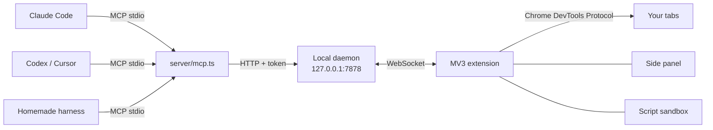

<p align="center">
  <a href="README.md">Français</a> · <b>English</b>
</p>

<p align="center">
  
</p>

<p align="center">
  <b>Agent Browser Control</b> (ABC for short) gives any AI agent, whether it's Claude Code, Codex, Cursor or a
  homemade harness running on DeepSeek, the controls of <b>your real browser</b>:
  your tabs, your sessions, and everything the DevTools can see.<br>
  One Chrome extension, one MCP server, and that's it.
</p>

<p align="center">
  <a href="#installation">Installation</a> ·
  <a href="#the-tools">The 41 tools</a> ·
  <a href="#the-side-panel">The side panel</a> ·
  <a href="#security">Security</a> ·
  <a href="#architecture">Architecture</a>
</p>

<p align="center">
  
</p>

## Why Agent Browser Control

- **Your real browser.** Not a headless Chromium running on the side: the agent works in your tabs, with the
  accounts you're already signed in to. It sees what you see.
- **Any agent.** Everything goes through [MCP](https://modelcontextprotocol.io): one line of configuration and the
  agent gets all 41 tools, whatever model runs behind it.
- **Far more than a click driver.** Accessibility tree with stable references, iframes (even cross-origin),
  network, WebSocket, console, cookies, performance, mobile emulation, request interception, GIF or video
  recording… The agent gets the DevTools, not just a mouse.
- **You stay in charge.** Each agent has its own colored tab group, every action shows up live, and an emergency
  stop cuts everything instantly.

## The side panel

<table>
  <tr>
    <td width="320"></td>
    <td>
      <p>Click the extension icon to open the supervision panel (the interface is currently in French):</p>
      <ul>
        <li><b>Emergency stop</b>: cuts every running action and detaches the agents; “Réarmer” (re-arm) to resume.</li>
        <li><b>Agents</b>: one click takes you to an agent's tab group, whichever window it's in.</li>
        <li><b>Activity log</b>: every action, its duration and its errors, filterable by agent.</li>
        <li><b>Agent scripts</b>: allow <code>browser_script</code> or not (see below).</li>
        <li><b>Blocked sites</b>: your bank, your password manager… agents never get in.</li>
      </ul>
      <p>On the controlled page, a purple outline and a ripple on every click show what the agent is doing.</p>
    </td>
  </tr>
</table>

## Installation

> Requirements: **Node.js 22.18+** and a Chromium-based browser (tested on Comet, meant for Chrome, Edge, Brave…).
> Optional: [yt-dlp](https://github.com/yt-dlp/yt-dlp) and ffmpeg for `download_media`.

**1. Get the project**

```sh
git clone https://github.com/salmund/agent-browser-control.git
cd agent-browser-control
npm install
```

**2. Load the extension**: open `chrome://extensions`, turn on *Developer mode*, click *Load unpacked* and pick the
`extension/` folder.

**3. Connect an agent**, with the same MCP configuration (stdio) for all of them:

```json
{
  "mcpServers": {
    "agent-browser-control": {
      "command": "node",
      "args": ["/path/to/agent-browser-control/server/mcp.ts"]
    }
  }
}
```

With Claude Code: `claude mcp add agent-browser-control -- node /path/to/agent-browser-control/server/mcp.ts`

That's all: the local daemon starts by itself on the first call. The agent's name, which is also the name of its
tab group, is the one announced by the MCP client; use `--agent-name my-agent` to pick your own.

**Several agents in parallel.** Sub-agents of a workflow share their parent's connection, hence its name. Each one
passes a short `label` to `tabs_context` and `tabs_create`: it gets its own "agent · label" group (distinct
colour), its own chip in the panel and labelled lines in the log. Without `label`, nothing changes. Tabs still
belong to the base agent: separation between sub-agents relies on discipline (each one only works on its own
tabs), not on a prohibition.

**Your browser stays yours.** By default, agents work in the background: they don't open their tabs in the foreground
and don't change your active tab. But Chrome doesn't paint a hidden tab: virtualized lists (AngularJS Material, CDK,
react-window…) stay empty there, and mouse events wait for their timeout (a click ~5 s, a scroll 60 s). For a click, a
scroll or reading such a list, the agent's tab therefore comes to the front for the duration of the gesture (0.8 s
hold so gestures can chain), then you get your tab back. Reading, keyboard typing, navigation and screenshots touch
nothing. The "Foreground" switch in the panel restores the old behaviour (agent tab brought to the front on every action).

## The tools

| | Tools |
|---|---|
| **Tabs** | `tabs_context` (with each tab's age) · `tabs_create` (incognito too) · `tabs_close` · `tabs_cleanup` (closes idle tabs, `dryRun` to preview) · `history_search` (find a visited page) · `navigate` · `resize_window` |
| **See** | `read_page` (accessibility tree with refs, iframes included: full, on-screen only or as a diff) · `find` · `scroll_extract` (infinite lists extracted in a single call) · `query` (structured extraction: selector + filter + pagination) · `get_page_text` (canvas pages too: Google Docs, Sheets, Slides export or OCR) · `save_image` · `read_screen_text` (local OCR) · `transcript` (the text of a YouTube video, without downloading anything) · `downloads` (download a file with your session, follow a download) · `read_document` (PDF, even scanned, Word, PowerPoint, Excel) |
| **Act** | `computer` (screenshot, clicks, typing, keys, scrolling, drag and drop) · `form_input` · `credentials_fill` (fills logins / passwords without ever seeing them: encrypted vault, extension side panel Secrets section) · `credentials_list` · `file_upload` · `wait_for` · `handle_dialog` |
| **DevTools** | `replay_paginated` (replay an observed API pagination, no scrolling) · `javascript` · `read_console_messages` · `read_network_requests` · `site_api` (per-site memory: routes + calls, replay fast without rediscovering) · `network_har` (persistent network recording, HAR export with secrets masked) · `network_intercept` · `network_get_body` · `storage` · `performance_metrics` · `emulate` · `pdf` · `read_websocket_messages` · `http_request` |
| **Record, automate** | `gif_creator` (high-quality GIF or WebM video) · `browser_script` · `download_media` (a page's video, audio or subtitles, with yt-dlp) |

A few details that make all the difference on real websites:

- **`wait_for`** waits for a condition (an element, a text appearing or disappearing, a URL, a quiet network)
  instead of a fixed number of seconds. A 9-second image generation? It hands control back at second 9.
- **Windows covering the page**, such as cookie banners or modals, are flagged at the top of every read, with the
  buttons to close them and the instruction to decline non-essential cookies.
- **`file_upload`** also works when the site opens the file picker on click: the system dialog is intercepted, so
  the agent never has to deal with it.
- **`read_page` in `diff` mode** only returns what changed since the previous read: less context, more speed.
- **Compound actions (1 LLM turn instead of 2 or 3)**: `navigate` and `tabs_create` accept `snapshot: true` to directly return the interactive accessibility tree as soon as loading completes; `computer` and `form_input` accept `snapshot: true` or `then: "diff"` to settle the DOM (300 ms) and return the updated tree or diff immediately.

### `browser_script`: dozens of actions in a single call

For repetitive tasks, the agent can write a small program that runs in one go, with no round trip to the model:

```js
// Today's Hacker News stories, sorted by score
await nav("https://news.ycombinator.com/");
const stories = await js(String.raw`[...document.querySelectorAll("tr.athing")].map((row) => ({
  title: row.querySelector(".titleline > a")?.textContent,
  points: parseInt(row.nextElementSibling?.querySelector(".score")?.textContent) || 0,
}))`);
return stories.sort((a, b) => b.points - a.points).slice(0, 10);
```

The script runs in a *sandbox* page of the extension, with no network and no browser APIs, and can only act
through the tools, with the same safeguards. Because it chains actions without looking at the page in between,
**it is disabled by default**: you're the one who allows it, in the side panel. More examples in
[`examples/scripts/`](examples/scripts): comparing cities on Wikipedia, checking a page for broken links.

### With Claude Code

To make Claude Code prefer Agent Browser Control over Claude in Chrome, copy the skill in
[`integrations/claude-code/skills/agent-browser-control`](integrations/claude-code/skills/agent-browser-control)
to `~/.claude/skills/`. It tells Claude when and how to use the tools (written in French).

## Security

- **Everything stays on your machine.** The daemon listens on `127.0.0.1` with a token; it rejects any request
  coming from a web page and only accepts your extension.
- **Page content is data, not instructions.** Everything coming from a page is marked as untrusted, so the agent
  doesn't follow booby-trapped text.
- **Each agent stays in its own tabs**, and never enters the sites you've blocked.
- **`http_request` is sent without cookies**: the agent can query an API, not act on your behalf on your accounts.
- **The emergency stop** cuts everything, including a running script.

## Architecture



- **`server/`**: the MCP server (one per agent) and the daemon that links them to the extension. TypeScript run
  directly by Node, no build step.
- **`extension/`**: the Manifest V3 extension. The service worker drives the tabs through `chrome.debugger`,
  `page.js` reads pages and their iframes, the side panel supervises.

## Development

```sh
npm run typecheck          # TypeScript check
npm run reload-extension   # reload the extension after a change
node test/smoke.ts         # end-to-end test without a browser
node test/call.ts <tool> '<json>'   # call a tool the way an agent would
npm run build-icons        # extension icons from the SVGs
npm run build-docs         # this README's visuals from the SVGs
```

The detailed design (in French) is in [`SPEC.md`](SPEC.md).

## License

[MIT](LICENSE): free to use, modify and redistribute, including for commercial purposes.
