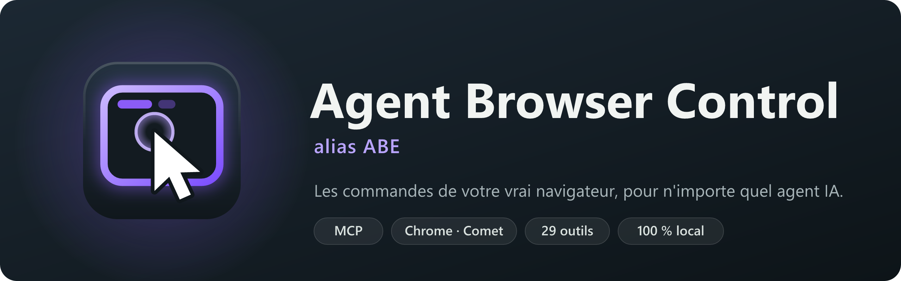
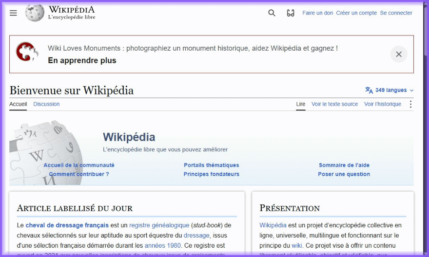
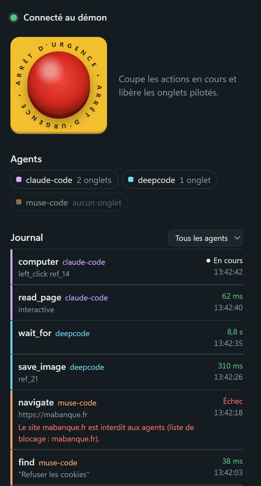
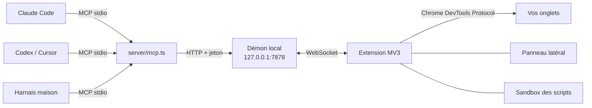

<p align="center">
  <b>Français</b> · <a href="README.en.md">English</a>
</p>

<p align="center">
  
</p>

<p align="center">
  <b>Agent Browser Control</b> (ABC pour les intimes) donne à n'importe quel agent IA, que ce soit Claude Code,
  Codex, Cursor ou un harnais maison sur DeepSeek, les commandes de <b>votre vrai navigateur</b> :
  vos onglets, vos sessions, et tout ce que voient les DevTools.<br>
  Une extension Chrome, un serveur MCP, et c'est tout.
</p>

<p align="center">
  <a href="#installation">Installation</a> ·
  <a href="#les-outils">Les 35 outils</a> ·
  <a href="#le-panneau">Le panneau</a> ·
  <a href="#sécurité">Sécurité</a> ·
  <a href="#architecture">Architecture</a>
</p>

<p align="center">
  
</p>

## Pourquoi Agent Browser Control

- **Votre vrai navigateur.** Pas un Chromium headless lancé à côté : l'agent travaille dans vos onglets, avec vos
  comptes déjà connectés. Il voit ce que vous voyez.
- **N'importe quel agent.** Tout passe par [MCP](https://modelcontextprotocol.io) : une ligne de configuration, et
  l'agent dispose des 35 outils, quel que soit le modèle derrière.
- **Bien plus qu'un pilote de clics.** Arbre d'accessibilité avec des références stables, iframes (même d'une autre
  origine), réseau, WebSocket, console, cookies, performance, émulation mobile, interception de requêtes,
  enregistrement GIF ou vidéo… L'agent a les DevTools, pas seulement une souris.
- **Vous gardez la main.** Chaque agent a son groupe d'onglets coloré, chaque action s'affiche en direct, et un
  arrêt d'urgence coupe tout instantanément.

## Le panneau

<table>
  <tr>
    <td width="320"></td>
    <td>
      <p>Un clic sur l'icône de l'extension ouvre le panneau. Trois vues : Activité, Réglages, Secrets.</p>
      <ul>
        <li><b>En attente de votre réponse</b> : un agent vous passe la main (captcha, 2FA) ou demande un secret ; la carte dit pourquoi et combien de temps il attend. L'icône de l'extension affiche le nombre de demandes.</li>
        <li><b>Agents</b> : une ligne par agent et par sous-agent, avec ce qu'il fait en mots simples. Sur chaque ligne : lui écrire, afficher ses onglets, le mettre en pause, fermer ses onglets.</li>
        <li><b>Écrire à un agent</b> : « Reste sur les sources françaises », « Arrête-toi après le résumé »… Le message arrive en tête de la réponse de sa prochaine action ; le panneau affiche « En attente » puis « Lu à 11:30 ».</li>
        <li><b>Journal</b> : chaque action, son site, sa durée, ses erreurs ; filtrable par agent ou par échecs, chaque ligne se déplie.</li>
        <li><b>Tout arrêter</b> (ou <kbd>Alt</kbd>+<kbd>Maj</kbd>+<kbd>S</kbd>) : les actions en cours s'arrêtent net et l'agent en est prévenu ; <kbd>Alt</kbd>+<kbd>Maj</kbd>+<kbd>R</kbd> pour reprendre.</li>
        <li><b>Réglages</b> : premier plan, scripts d'agent, gestes visibles, sites interdits (votre banque, votre gestionnaire de mots de passe…).</li>
      </ul>
    </td>
  </tr>
</table>

## Installation

> Prérequis : **Node.js 22.18+** et un navigateur Chromium (testé sur Comet, prévu pour Chrome, Edge, Brave…).
> Facultatif : [yt-dlp](https://github.com/yt-dlp/yt-dlp) et ffmpeg pour `download_media`.

**1. Récupérer le projet** (ou en une ligne : voir install.ps1 / install.sh)

```sh
git clone https://github.com/salmund/agent-browser-control.git
cd agent-browser-control
npm install
```

**2. Charger l'extension** : `chrome://extensions`, activer le *mode développeur*, puis *Charger l'extension non
empaquetée* et choisir le dossier `extension/`.

> **Comet (et tout navigateur qui bloque des sites aux extensions)** : depuis Chrome 155, une extension qui a des
> sites bloqués perd le debugger (« Host access is restricted by policy. »). Comet bloque les sites de Perplexity à
> toutes les extensions, en dur. ABC rejoue alors gestes et lectures par la page (`/health` : `debuggerBlocked`),
> sans réseau ni console. Remède durable : une stratégie qui ne bloque rien pour ABC (remplacer `<id>` par
> l'identifiant de l'extension, affiché dans `chrome://extensions`), dans un PowerShell administrateur, puis
> redémarrer Comet :
>
> ```powershell
> New-Item 'HKCU:\Software\Policies\Perplexity\Comet' -Force | Out-Null
> New-ItemProperty 'HKCU:\Software\Policies\Perplexity\Comet' -Name ExtensionSettings -PropertyType String -Force `
>   -Value '{"<id>":{"runtime_blocked_hosts":[],"runtime_allowed_hosts":[]}}'
> ```
>
> Autre navigateur : même stratégie sous sa propre clé (Chrome : `Google\Chrome`). Solution d'appoint jusqu'à
> Chrome 160 : lancer le navigateur avec `--disable-features=ExtensionDebuggerStrictPolicyRestrictions`.

**3. Brancher un agent**, avec la même configuration MCP (stdio) pour tous :

```json
{
  "mcpServers": {
    "agent-browser-control": {
      "command": "node",
      "args": ["/chemin/vers/agent-browser-control/server/mcp.ts"]
    }
  }
}
```

Avec Claude Code : `claude mcp add agent-browser-control -- node /chemin/vers/agent-browser-control/server/mcp.ts`

C'est tout : le démon local démarre de lui-même au premier appel. Le nom de l'agent, qui est aussi celui de son
groupe d'onglets, est celui qu'annonce le client MCP ; `--agent-name mon-agent` permet de le choisir.

**Ou en HTTP**, si votre client sait parler MCP en Streamable HTTP : le démon sert directement `/mcp`, sans processus
intermédiaire (il doit alors déjà tourner, par exemple lancé par un agent stdio ou par `node server/daemon.ts`).
Le nom de l'agent se passe dans l'URL, le jeton est le contenu du fichier `~/.agent-browser-control/token` :

```json
{
  "mcpServers": {
    "agent-browser-control": {
      "type": "http",
      "url": "http://127.0.0.1:7878/mcp?agent=mon-agent",
      "headers": { "Authorization": "Bearer <contenu de ~/.agent-browser-control/token>" }
    }
  }
}
```

**Première connexion de l'extension.** Le démon retient l'identifiant de la première extension qui s'y connecte et
refuse ensuite toutes les autres. Si vous rechargez l'extension depuis un autre dossier (son identifiant change),
lancez `npm run unpin-extension` puis rechargez-la.

**Plusieurs agents en parallèle.** Des sous-agents d'un workflow partagent la connexion de leur parent, donc son
nom. Chacun passe alors un `label` court à `tabs_context` et `tabs_create` : il a son groupe « agent · label »
(couleur distincte), sa pastille dans le panneau et ses lignes étiquetées dans le journal. Sans `label`, rien ne
change. Les onglets restent à l'agent de base : le cloisonnement entre sous-agents repose sur la discipline
(chacun ne travaille que sur ses onglets), pas sur une interdiction.

**Votre navigateur reste à vous.** Par défaut, les agents travaillent en arrière-plan : ils n'ouvrent pas leurs onglets
au premier plan et ne changent pas votre onglet actif. Mais Chrome ne dessine pas un onglet masqué : les listes
virtualisées (AngularJS Material, CDK, react-window…) y restent vides, et les événements souris y attendent leur délai
(un clic ~5 s, un défilement 60 s). Pour un clic, un défilement ou la lecture d'une telle liste, l'onglet de l'agent passe
donc devant le temps du geste (0,8 s de garde pour enchaîner), puis vous retrouvez votre onglet. Lecture, saisie au
clavier, navigation et captures se font sans rien toucher. L'interrupteur « Premier plan » du panneau redonne l'ancien
comportement (onglet de l'agent devant à chaque action).

**Souris réelle, pour une machine dédiée aux agents.** Un geste simulé saute sur le centre exact de sa cible, sans
trajet : les protections anti-robot (Turnstile, reCAPTCHA, DataDome…) le repèrent. Sur une machine dont l'écran sert
aux agents (un mini-PC sous Linux, par exemple), l'interrupteur « Souris réelle » du panneau fait passer clics, survols,
défilements et glisser par le vrai pointeur, que le démon déplace (X11, `xdotool`) le long d'un trajet de main : arc,
vitesse en cloche, léger dépassement des cibles lointaines. L'extension vérifie que la page a vu le pointeur arriver au
bon endroit avant de cliquer, et revient au geste simulé si la souris réelle est indisponible. Un trajet de main coûte
0,5 à 1,5 s : il ne sert que là où une protection juge le comportement (widget ou script anti-robot, défi Cloudflare,
page de connexion, site protégé vu depuis moins de 30 min) ; ailleurs, le geste reste simulé et rapide. L'agent peut
trancher pour un geste (`computer`, `human: true` ou `false`). Désactivé par défaut : sur votre PC, le pointeur reste à
vous.

## Les outils

| | Outils |
|---|---|
| **Onglets** | `tabs_context` (avec l'âge de chaque onglet) · `tabs_create` (aussi en navigation privée) · `tabs_close` · `tabs_cleanup` (ferme les inactifs, `dryRun` pour prévisualiser) · `history_search` (retrouver une page visitée) · `navigate` |
| **Voir** | `read_page` (arbre d'accessibilité avec refs, iframes comprises : en entier, à l'écran seulement ou en différentiel) · `find` · `scroll_extract` (listes à chargement progressif extraites en un appel) · `query` (extraction structurée : sélecteur + filtre + pagination) · `read_tables` (tableaux en Markdown ou CSV) · `get_page_text` (aussi pour les pages en canvas : export Google Docs, Sheets, Slides ou OCR) · `save_image` · `read_screen_text` (OCR locale) · `transcript` (le texte d'une vidéo YouTube, sans rien télécharger) · `downloads` (télécharger un fichier avec votre session, suivre un téléchargement) · `read_document` (PDF, même scanné, Word, PowerPoint, Excel) |
| **Agir** | `computer` (capture, clics, saisie, touches, défilement, glisser-déposer) · `form_input` · `credentials_fill` (remplit identifiants / mots de passe sans jamais les voir : coffre chiffré ou votre Vaultwarden / Bitwarden, onglet Secrets du panneau) · `credentials_list` · `file_upload` · `wait_for` · `handle_dialog` · `ask_human` (passer la main à l'utilisateur : captcha, 2FA, validation) · `captcha_solve` (résout Turnstile, reCAPTCHA, hCaptcha) |
| **DevTools** | `replay_paginated` (rejouer une pagination d'API observée, sans scroller) · `javascript` · `devtools` (console, réseau, interceptions, stockage, perf, émulation, PDF, WebSocket, HTTP, HAR, redimensionnement : 12 outils en un) · `site_api` (mémoire par site : routes + appels, pour rejouer vite sans redécouvrir) |
| **Enregistrer, automatiser** | `gif_creator` (GIF haute qualité ou vidéo WebM) · `browser_script` · `download_media` (vidéo, audio ou sous-titres d'une page, avec yt-dlp) · `watch` (surveillances persistantes : le démon vérifie seul, périodiquement) · `demo` (l'utilisateur montre le parcours, l'agent le rejoue) |

Quelques détails qui changent tout sur les vrais sites :

- **`wait_for`** attend une condition (un élément, un texte qui apparaît ou disparaît, une URL, un réseau calme)
  plutôt qu'un nombre de secondes. Une génération d'image de 9 s ? Il rend la main à la 9ᵉ seconde.
- **Les fenêtres qui recouvrent la page**, comme les bannières de cookies ou les modales, sont signalées en tête de
  chaque lecture, avec les boutons pour les fermer et la consigne de refuser les cookies non essentiels. Un mur de
  cookies qui ne laisse pas refuser (« accepter ou s'abonner ») est accepté plutôt que de bloquer la page.
- **`file_upload`** fonctionne aussi quand le site ouvre le sélecteur de fichiers au clic : la boîte de dialogue
  système est interceptée, l'agent n'a jamais à la manipuler.
- **`read_page` en mode `diff`** ne renvoie que ce qui a changé depuis la lecture précédente : moins de contexte,
  plus de vitesse.
- **Actions composées (1 tour au lieu de 2 ou 3)** : `navigate` et `tabs_create` acceptent `snapshot: true` pour renvoyer directement l'arbre interactif dès le chargement terminé ; `computer` et `form_input` acceptent `snapshot: true` ou `then: "diff"` pour stabiliser le DOM (300 ms) et renvoyer le résultat ou le différentiel immédiatement.

### `browser_script` : des dizaines d'actions en un seul appel

Pour les tâches répétitives, l'agent peut écrire un petit programme qui s'exécute d'une traite, sans aller-retour
avec le modèle :

```js
// Les articles du jour sur Hacker News, triés par score
await nav("https://news.ycombinator.com/");
const articles = await js(String.raw`[...document.querySelectorAll("tr.athing")].map((row) => ({
  titre: row.querySelector(".titleline > a")?.textContent,
  points: parseInt(row.nextElementSibling?.querySelector(".score")?.textContent) || 0,
}))`);
return articles.sort((a, b) => b.points - a.points).slice(0, 10);
```

Le script tourne dans une page *sandbox* de l'extension, sans réseau ni API du navigateur, et n'agit qu'à travers
les outils, avec les mêmes garde-fous. Comme il enchaîne les actions sans regarder la page entre deux, **il est
activé par défaut** : vous pouvez le désactiver dans le panneau. D'autres exemples dans
[`examples/scripts/`](examples/scripts) : comparer des villes sur Wikipédia, vérifier les liens cassés d'une page.

### Avec Claude Code

Pour que Claude Code préfère Agent Browser Control à Claude in Chrome, copiez le skill
[`integrations/claude-code/skills/agent-browser-control`](integrations/claude-code/skills/agent-browser-control)
dans `~/.claude/skills/`. Il lui explique quand et comment utiliser les outils.

### Vaultwarden ou Bitwarden : vos identifiants, sans les donner à l'agent

L'agent peut se connecter à vos sites avec les identifiants de **votre** coffre, sans jamais les voir :

1. Installez une fois le CLI Bitwarden (gratuit, il sert aussi pour Vaultwarden) : `winget install --id Bitwarden.CLI`.
2. Panneau, onglet **Secrets**, bloc **Vaultwarden / Bitwarden** : l'adresse du serveur est retrouvée dans vos onglets
   ou votre historique (titre « Vaultwarden Web », hôte `passwords.*`, `vault.*`) puis vérifiée ; saisissez votre
   e-mail et votre mot de passe maître (et le code en deux étapes s'il est demandé). C'est tout.
3. L'agent utilise le slot `vaultwarden` : `credentials_fill` prend l'élément du coffre associé au site de l'onglet
   (règles d'adresse du coffre), vous demande l'autorisation dans le panneau, choisissez le compte s'il y en a
   plusieurs, et cochez « Toujours autoriser sur ce site » pour ne plus être sollicité. `credentials_list` montre aussi
   les éléments du coffre associés à la page (`bw-<id>`).
4. Coffre verrouillé au moment où l'agent en a besoin : une carte apparaît dans le panneau (et une notification) ;
   saisissez le mot de passe maître, l'agent reprend tout seul (attente de 2 min au plus).

Le CLI tourne dans un profil propre à ABC (`~/.agent-browser-control/bitwarden`) : votre `bw` habituel n'est pas
déconnecté (`ABC_BW_PROFILE=default` pour partager le même profil). Le mot de passe maître n'est jamais écrit ni
journalisé : il passe au CLI par une variable d'environnement, et la clé de session reste en mémoire du démon.
Coffre ouvert, le démon garde un `bw serve` sur un socket privé (jamais un port réseau) : lister puis remplir un
identifiant prend quelques millisecondes au lieu de 3 à 4 s par appel au CLI (`ABC_BW_SERVE=0` pour s'en passer).
Seule l'origine de la page (pas son chemin) est envoyée au CLI pour trouver les éléments correspondants. Un serveur
privé (Tailscale, réseau local) doit être joignable depuis ce PC.

### Machine sans écran : répondre aux demandes depuis une messagerie

Sur un serveur où personne ne regarde le panneau, le démon peut relayer chaque demande qui attend l'utilisateur
(accord pour un secret, `ask_human`, coffre verrouillé) vers un service local, par exemple un assistant sur
Telegram. Il suffit d'un fichier `~/.agent-browser-control/relay.json` :

```json
{"url": "http://127.0.0.1:8096/api/abc/demandes", "headers": {"X-Argos": "1"}, "bureauUrl": "https://exemple/bureau"}
```

Le service reçoit `{"event": "request", "id", "kind", "agent", "text", "detail", "site", "until", "choices",
"replyUrl", "replyToken"}` puis `{"event": "done", "id"}` quand la demande est réglée ailleurs. Pour répondre, il
envoie `{"id", "token", "decision"}` (et `note` pour `ask_human`) à `replyUrl` : même effet qu'un clic dans le
panneau. Le jeton est propre à la demande et ne sert qu'une fois ; le mot de passe maître ne passe jamais par là.

## Sécurité

- **Tout reste sur votre machine.** Le démon écoute sur `127.0.0.1` avec un jeton ; il refuse toute requête venue
  d'une page web (y compris par un nom de domaine qui pointerait vers votre machine) et n'accepte que votre
  extension, épinglée à sa première connexion.
- **Le contenu des pages est une donnée, pas une instruction.** Tout ce qui vient d'une page est balisé comme non
  fiable, pour que l'agent ne suive pas un texte piégé. Les notes de mémoire de site, écrites par des agents, sont
  servies de la même façon : comme une donnée non vérifiée.
- **Vos fichiers sensibles ne partent pas.** `file_upload` refuse clés SSH, `.env`, certificats, HAR, profils de
  navigateur et dossiers de configuration, avant même d'atteindre la page.
- **Le journal ne garde pas vos saisies** : textes tapés, mots de passe, corps de requêtes et paramètres d'URL y sont
  réduits à leur longueur ou masqués.
- **Chaque agent reste dans ses onglets**, et n'entre jamais sur les sites que vous avez interdits.
- **`http_request` part sans cookies** : l'agent peut interroger une API, pas agir en votre nom sur vos comptes.
- **L'arrêt d'urgence** coupe tout, y compris un script en cours ; la pause d'un agent ne coupe que lui.
- **Les pages de l'extension vous sont réservées** : aucun agent ne peut ouvrir le panneau ni y cliquer, donc
  aucun ne peut approuver lui-même une demande de secret. Seul le panneau peut écrire un message à un agent.
- **Vos onglets restent les vôtres** : un onglet que vous ouvrez depuis un onglet d'agent vous revient ; seuls ceux
  qu'une action d'agent ouvre (lien, popup de connexion) rejoignent son groupe.

## Architecture



- **`server/`** : le serveur MCP (un par agent) et le démon qui les relie à l'extension. TypeScript exécuté
  directement par Node, sans étape de build.
- **`extension/`** : l'extension Manifest V3. Le service worker pilote les onglets via `chrome.debugger`,
  `page.js` lit les pages et leurs iframes, le panneau supervise.

## Développement

```sh
npm run typecheck          # vérification TypeScript
npm run reload-extension   # recharge l'extension après une modification
node scripts/run-tests.ts  # suite rapide sans navigateur (--e2e : tests dans le navigateur)
node test/smoke.ts         # test de bout en bout sans navigateur (démon de test, dossier temporaire)
node test/mcp-http.ts      # endpoint MCP HTTP avec le client du SDK
node test/call.ts <outil> '<json>'   # appeler un outil comme le ferait un agent
npm run build-icons        # icônes de l'extension depuis les SVG
npm run build-docs         # visuels de ce README depuis les SVG
```

La conception détaillée est dans [`SPEC.md`](SPEC.md).

## Licence

[MIT](LICENSE) : libre d'utilisation, de modification et de redistribution, y compris à des fins commerciales.
