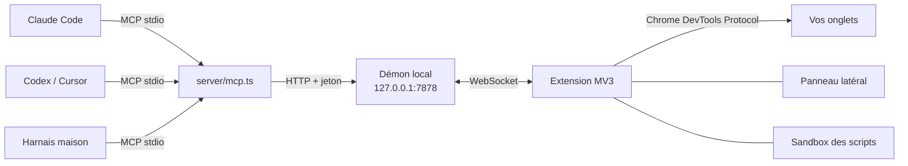

<p align="center">
  <b>Français</b> · <a href="README.en.md">English</a>
</p>

<p align="center">
  
</p>

<p align="center">
  <b>Agent Browser Control</b> (ABE pour les intimes) donne à n'importe quel agent IA, que ce soit Claude Code,
  Codex, Cursor ou un harnais maison sur DeepSeek, les commandes de <b>votre vrai navigateur</b> :
  vos onglets, vos sessions, et tout ce que voient les DevTools.<br>
  Une extension Chrome, un serveur MCP, et c'est tout.
</p>

<p align="center">
  <a href="#installation">Installation</a> ·
  <a href="#les-outils">Les 28 outils</a> ·
  <a href="#le-panneau">Le panneau</a> ·
  <a href="#sécurité">Sécurité</a> ·
  <a href="#architecture">Architecture</a>
</p>

<p align="center">
  
</p>

## Pourquoi Agent Browser Control

- **Votre vrai navigateur.** Pas un Chromium headless lancé à côté : l'agent travaille dans vos onglets, avec vos
  comptes déjà connectés. Il voit ce que vous voyez.
- **N'importe quel agent.** Tout passe par [MCP](https://modelcontextprotocol.io) : une ligne de configuration, et
  l'agent dispose des 28 outils, quel que soit le modèle derrière.
- **Bien plus qu'un pilote de clics.** Arbre d'accessibilité avec des références stables, iframes (même d'une autre
  origine), réseau, WebSocket, console, cookies, performance, émulation mobile, interception de requêtes,
  enregistrement GIF ou vidéo… L'agent a les DevTools, pas seulement une souris.
- **Vous gardez la main.** Chaque agent a son groupe d'onglets coloré, chaque action s'affiche en direct, et un
  arrêt d'urgence coupe tout instantanément.

## Le panneau

<table>
  <tr>
    <td width="320"></td>
    <td>
      <p>Un clic sur l'icône de l'extension ouvre le panneau de supervision :</p>
      <ul>
        <li><b>Arrêt d'urgence</b> : coupe toutes les actions en cours et détache les agents ; « Réarmer » pour reprendre.</li>
        <li><b>Agents</b> : un clic amène à leur groupe d'onglets, quelle que soit la fenêtre.</li>
        <li><b>Journal</b> : chaque action, sa durée, ses erreurs, filtrable par agent.</li>
        <li><b>Scripts d'agent</b> : autoriser ou non <code>browser_script</code> (voir plus bas).</li>
        <li><b>Sites interdits</b> : votre banque, votre gestionnaire de mots de passe… les agents n'y entrent pas.</li>
      </ul>
      <p>Sur la page pilotée, une bordure violette et une onde à chaque clic montrent ce que fait l'agent.</p>
    </td>
  </tr>
</table>

## Installation

> Prérequis : **Node.js 22.18+** et un navigateur Chromium (testé sur Comet, prévu pour Chrome, Edge, Brave…).

**1. Récupérer le projet**

```sh
git clone https://github.com/salmund/agent-browser-control.git
cd agent-browser-control
npm install
```

**2. Charger l'extension** : `chrome://extensions`, activer le *mode développeur*, puis *Charger l'extension non
empaquetée* et choisir le dossier `extension/`.

**3. Brancher un agent**, avec la même configuration MCP (stdio) pour tous :

```json
{
  "mcpServers": {
    "agent-browser-control": {
      "command": "node",
      "args": ["/chemin/vers/agent-browser-control/server/mcp.ts"]
    }
  }
}
```

Avec Claude Code : `claude mcp add agent-browser-control -- node /chemin/vers/agent-browser-control/server/mcp.ts`

C'est tout : le démon local démarre de lui-même au premier appel. Le nom de l'agent, qui est aussi celui de son
groupe d'onglets, est celui qu'annonce le client MCP ; `--agent-name mon-agent` permet de le choisir.

## Les outils

| | Outils |
|---|---|
| **Onglets** | `tabs_context` · `tabs_create` (aussi en navigation privée) · `tabs_close` · `navigate` · `resize_window` |
| **Voir** | `read_page` (arbre d'accessibilité avec refs, iframes comprises : en entier, à l'écran seulement ou en différentiel) · `find` · `get_page_text` (aussi pour les pages en canvas : export Google Docs, Sheets, Slides ou OCR) · `read_screen_text` (OCR locale) · `save_image` |
| **Agir** | `computer` (capture, clics, saisie, touches, défilement, glisser-déposer) · `form_input` · `file_upload` · `wait_for` · `handle_dialog` |
| **DevTools** | `javascript` · `read_console_messages` · `read_network_requests` · `network_get_body` · `network_intercept` · `read_websocket_messages` · `http_request` · `storage` · `performance_metrics` · `emulate` · `pdf` |
| **Enregistrer, automatiser** | `gif_creator` (GIF haute qualité ou vidéo WebM) · `browser_script` |

Quelques détails qui changent tout sur les vrais sites :

- **`wait_for`** attend une condition (un élément, un texte qui apparaît ou disparaît, une URL, un réseau calme)
  plutôt qu'un nombre de secondes. Une génération d'image de 9 s ? Il rend la main à la 9ᵉ seconde.
- **Les fenêtres qui recouvrent la page**, comme les bannières de cookies ou les modales, sont signalées en tête de
  chaque lecture, avec les boutons pour les fermer et la consigne de refuser les cookies non essentiels.
- **`file_upload`** fonctionne aussi quand le site ouvre le sélecteur de fichiers au clic : la boîte de dialogue
  système est interceptée, l'agent n'a jamais à la manipuler.
- **`read_page` en mode `diff`** ne renvoie que ce qui a changé depuis la lecture précédente : moins de contexte,
  plus de vitesse.

### `browser_script` : des dizaines d'actions en un seul appel

Pour les tâches répétitives, l'agent peut écrire un petit programme qui s'exécute d'une traite, sans aller-retour
avec le modèle :

```js
// Les articles du jour sur Hacker News, triés par score
await nav("https://news.ycombinator.com/");
const articles = await js(String.raw`[...document.querySelectorAll("tr.athing")].map((row) => ({
  titre: row.querySelector(".titleline > a")?.textContent,
  points: parseInt(row.nextElementSibling?.querySelector(".score")?.textContent) || 0,
}))`);
return articles.sort((a, b) => b.points - a.points).slice(0, 10);
```

Le script tourne dans une page *sandbox* de l'extension, sans réseau ni API du navigateur, et n'agit qu'à travers
les outils, avec les mêmes garde-fous. Comme il enchaîne les actions sans regarder la page entre deux, **il est
désactivé par défaut** : c'est vous qui l'autorisez, dans le panneau. D'autres exemples dans
[`examples/scripts/`](examples/scripts) : comparer des villes sur Wikipédia, vérifier les liens cassés d'une page.

### Avec Claude Code

Pour que Claude Code préfère Agent Browser Control à Claude in Chrome, copiez le skill
[`integrations/claude-code/skills/agent-browser-control`](integrations/claude-code/skills/agent-browser-control)
dans `~/.claude/skills/`. Il lui explique quand et comment utiliser les outils.

## Sécurité

- **Tout reste sur votre machine.** Le démon écoute sur `127.0.0.1` avec un jeton ; il refuse toute requête venue
  d'une page web et n'accepte que votre extension.
- **Le contenu des pages est une donnée, pas une instruction.** Tout ce qui vient d'une page est balisé comme non
  fiable, pour que l'agent ne suive pas un texte piégé.
- **Chaque agent reste dans ses onglets**, et n'entre jamais sur les sites que vous avez interdits.
- **`http_request` part sans cookies** : l'agent peut interroger une API, pas agir en votre nom sur vos comptes.
- **L'arrêt d'urgence** coupe tout, y compris un script en cours.

## Architecture



- **`server/`** : le serveur MCP (un par agent) et le démon qui les relie à l'extension. TypeScript exécuté
  directement par Node, sans étape de build.
- **`extension/`** : l'extension Manifest V3. Le service worker pilote les onglets via `chrome.debugger`,
  `page.js` lit les pages et leurs iframes, le panneau supervise.

## Développement

```sh
npm run typecheck          # vérification TypeScript
npm run reload-extension   # recharge l'extension après une modification
node test/smoke.ts         # test de bout en bout sans navigateur
node test/call.ts <outil> '<json>'   # appeler un outil comme le ferait un agent
npm run build-icons        # icônes de l'extension depuis les SVG
npm run build-docs         # visuels de ce README depuis les SVG
```

La conception détaillée est dans [`SPEC.md`](SPEC.md).

## Licence

[MIT](LICENSE) : libre d'utilisation, de modification et de redistribution, y compris à des fins commerciales.
